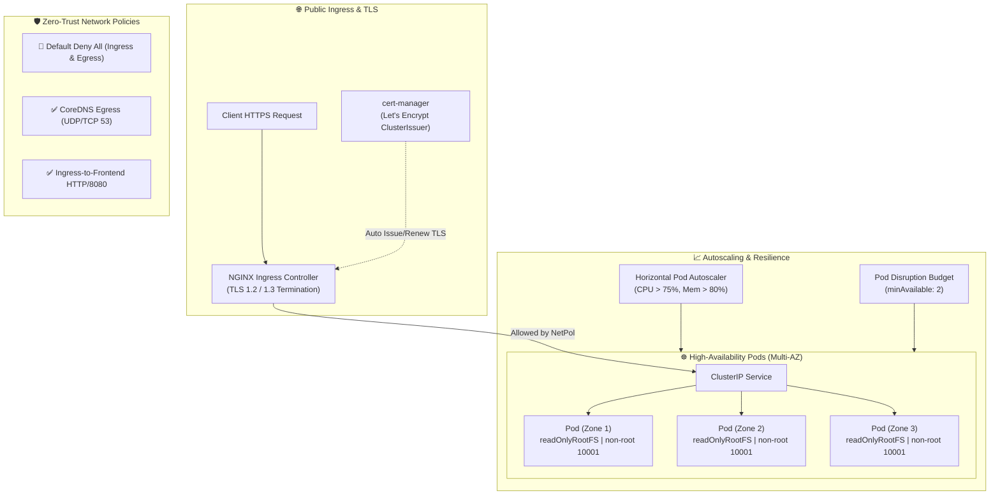

# ☸️ Kubernetes Production-Ready Platform Baseline

[](https://github.com/shyam-codeops/kubernetes-production-ready/actions)
[](https://kubernetes.io)
[](https://kustomize.io)
[](https://helm.sh)
[](https://kubernetes.io/docs/concepts/security/pod-security-standards/)
[](LICENSE)

Enterprise-grade, hardened **Kubernetes & Azure Kubernetes Service (AKS)** production baseline repository. Implements zero-trust networking, Pod Security Standards (Restricted profile), automated TLS certificate management with cert-manager, multi-AZ high availability with Topology Spread Constraints, Pod Disruption Budgets (PDB), Horizontal Pod Autoscaling (HPA), and environment-specific Kustomize overlays.

---

## 🏛️ Architecture & Traffic Flow



---

## 🔒 Security Hardening Matrix

| Security Control | Implementation | Purpose |
| :--- | :--- | :--- |
| **Pod Security Standards** | `pod-security.kubernetes.io/enforce: restricted` | Replaces deprecated PodSecurityPolicy with native admission control. |
| **Non-Root Execution** | `runAsNonRoot: true`, `runAsUser: 10001` | Prevents container breakouts from acquiring root host privileges. |
| **Immutable Filesystem** | `readOnlyRootFilesystem: true` | Blocks attackers from writing web shells or persistence binaries. |
| **Linux Capabilities** | `capabilities.drop: ["ALL"]` | Removes all kernel capabilities (`CAP_NET_RAW`, `CAP_SYS_ADMIN`, etc.). |
| **Privilege Escalation** | `allowPrivilegeEscalation: false` | Prevents `setuid` binaries from elevating process capabilities. |
| **Seccomp Profile** | `seccompProfile.type: RuntimeDefault` | Restricts dangerous system calls via standard Linux seccomp filters. |
| **Token Protection** | `automountServiceAccountToken: false` | Eliminates lateral movement risks by not mounting default K8s tokens. |
| **Network Isolation** | `NetworkPolicy (default-deny-all)` | Restricts all ingress/egress to explicitly whitelisted endpoints. |

---

## 📁 Repository Structure

```tree
kubernetes-production-ready/
├── .github/
│   └── workflows/
│       └── ci.yml                 # Automated manifest validation & unit tests
├── base/
│   ├── app/
│   │   ├── deployment.yaml        # Hardened workload with health probes
│   │   └── supporting-resources.yaml # Service, Ingress, HPA, PDB
│   ├── cert-manager/
│   │   └── cluster-issuer.yaml    # Let's Encrypt Staging & Prod issuers
│   ├── namespaces/
│   │   └── namespaces.yaml        # Production namespaces with PSS labels
│   ├── network-policies/
│   │   └── network-policies.yaml  # Default-deny, DNS egress, Ingress ingress
│   ├── rbac/
│   │   └── rbac.yaml              # Least-privilege ServiceAccounts and Roles
│   └── kustomization.yaml         # Base Kustomize bundle
├── overlays/
│   ├── dev/
│   │   └── kustomization.yaml     # 1 replica, staging TLS, dev host
│   └── prod/
│       └── kustomization.yaml     # 5 replicas, PCI-DSS labels, prod TLS
├── helm-charts/
│   └── microservice/
│       ├── Chart.yaml             # Microservice chart specification
│       ├── values.yaml            # Configurable production defaults
│       └── templates/             # Helm templated manifests
├── tests/
│   ├── __init__.py
│   └── test_k8s_manifests.py      # Automated security benchmark test suite
├── .gitignore
├── LICENSE
└── README.md
```

---

## 🚀 Quickstart & Verification

### 1. Run Automated Test Suite (Zero External Dependencies)
Validate Kustomize overlays and verify all security constraints:

```bash
git clone https://github.com/shyam-codeops/kubernetes-production-ready.git
cd kubernetes-production-ready

# Run unit tests
python -m unittest discover -s tests -p "test_*.py" -v
```

### 2. Inspect Generated Manifests
Generate and review hydrated manifests for each environment:

```bash
# Build Development Overlay
kubectl kustomize overlays/dev

# Build Production Overlay
kubectl kustomize overlays/prod
```

### 3. Deploy to Cluster
Apply the base or environment overlays using `kubectl`:

```bash
# Apply production overlay
kubectl apply -k overlays/prod
```

### 4. Deploy via Helm Chart
Alternatively, install workloads using the parameterized Helm chart:

```bash
helm upgrade --install payment-api ./helm-charts/microservice \
  --namespace production-apps \
  --set image.repository="ghcr.io/contoso/payment-api" \
  --set image.tag="v2.1.0" \
  --set ingress.hosts[0].host="api.contoso.com"
```

---

## 📈 High Availability & Disaster Recovery

* **Multi-Zone Scheduling**: Pods are evenly distributed across availability zones using `topologySpreadConstraints` with `topologyKey: topology.kubernetes.io/zone`.
* **Zero-Downtime Rollouts**: `strategy.rollingUpdate` configured with `maxSurge: 25%` and `maxUnavailable: 0`.
* **Disruption Protection**: `PodDisruptionBudget` guarantees at least 2 healthy pods remain available during Kubernetes node upgrades and drain events.
* **Auto-Scaling**: Horizontal Pod Autoscaler (HPA) automatically dynamically scales pods between 3 and 10 based on CPU & Memory load.

---

## 👤 Author

**Shyam Singh**
* GitHub: [@shyam-codeops](https://github.com/shyam-codeops)
* Role: DevOps & DevSecOps Engineer

---

## 📄 License
This project is licensed under the MIT License - see the [LICENSE](LICENSE) file for details.
